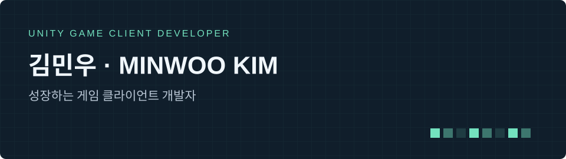
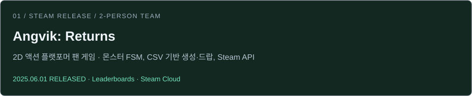
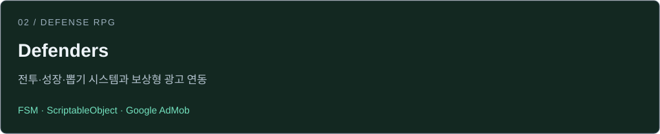
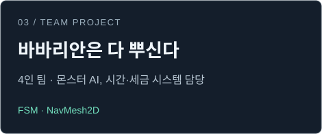
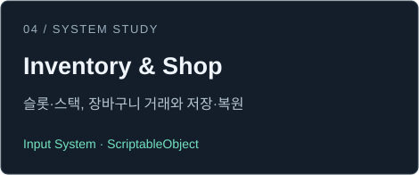

  

  SteamWorks, Firebase, Google AdMob 연동

  
  
  
  
  
  

  <a href="https://velog.io/@kmw6624/posts">기술 블로그 ↗</a> &nbsp; · &nbsp;
  <a href="https://github.com/K1M-MinW00/CodingTest">알고리즘 ↗</a> &nbsp; · &nbsp;
  <a href="https://solved.ac/kmw6624">solved.ac ↗</a>

## Education & Problem Solving

**🎓 경북대학교**

- 📐 수학과 졸업 · 2018.03 – 2024.02
- 💻 컴퓨터공학부 복수전공 · 2022.03 – 2024.02
- **📊 학점 3.5 / 4.3**

**🎮 내일배움캠프 Unity 4기**

- 🛠️ Unity 게임 개발 종합반
- 📅 2024.04 – 2024.08

 

## Selected Projects

  
  

## Inside the Code

<b>Angvik: Returns — 몬스터 AI와 Steam 연동</b>

**2인 팀 · 2D 액션 플랫포머 팬 게임**  
개발: 2024.10 – 2025.05 · Steam 출시: 2025.06.01

몬스터 FSM, CSV 기반 몬스터 생성 및 아이템 드랍 확률 관리, Steamworks 연동을 담당했습니다.

- **몬스터 AI** — 몬스터와 보스의 행동·공격 로직 구성
- **CSV 데이터** — 구역별 몬스터 종류·위치·생성 확률과 아이템 드랍 데이터 관리
- **Steam 리더보드** — 난이도별 순위 조회와 본인 기록 표시
- **Steam Cloud** — 키 설정, 해금 난이도, 마지막 사망 위치 등 저장·불러오기

[담당 코드](https://github.com/MJ99-Games/Angvik-Returns/tree/main/Assets/Scripts/KMW) · [CSV 로더](https://github.com/MJ99-Games/Angvik-Returns/blob/main/Assets/Scripts/KMW/Manager/CSVLoader.cs) · [리더보드](https://github.com/MJ99-Games/Angvik-Returns/blob/main/Assets/Scripts/KMW/Steam/LeaderboardManager.cs) · [클라우드 저장](https://github.com/MJ99-Games/Angvik-Returns/blob/main/Assets/Scripts/KMW/Steam/SteamCloudManager.cs)

[Steam](https://store.steampowered.com/app/3508090) · [트레일러](https://www.youtube.com/watch?v=IiK5NEWpR9E)

<b>Defenders — 전투·뽑기·광고 보상의 연결</b>

맵 생성과 참조 연결을 `StageBootstrapper`에 모으고, `GachaService`에서 등급 추첨과 천장 갱신을 처리합니다.

- 스테이지 데이터에 따라 배치 영역, 유닛·몬스터 스폰 위치, 카메라 경계 연결
- 일반·특별 모집의 천장 횟수 관리 및 등급별 유닛 추첨
- 유닛과 몬스터의 FSM, 공격 방식, 액티브·패시브 스킬 구성
- Google AdMob 보상형 광고 로드와 보상 콜백 처리
- 광고 보상 콜백 및 종료 이벤트에 연결한 연료 보상 지급

[스테이지 초기화 코드](https://github.com/K1M-MinW00/Defenders/blob/main/Assets/Scripts/Core/Bootstrap/StageBootstrapper.cs) · [뽑기 로직](https://github.com/K1M-MinW00/Defenders/blob/main/Assets/Scripts/Services/Gacha/GachaService.cs)

[광고 연동](https://github.com/K1M-MinW00/Defenders/blob/main/Assets/Scripts/System/Ads/AdManager.cs) · [연료 보상 연결](https://github.com/K1M-MinW00/Defenders/blob/main/Assets/Scripts/Features/Lobby/UI/FuelPanelView.cs)

<b>바바리안 — 몬스터의 상태와 행동 분리</b>

**4인 팀 프로젝트 · 2024.06.27 – 2024.08.20**

부팀장으로 몬스터, 시간·세금 시스템, 조명, 매뉴얼, 컷신을 담당했습니다.

- 몬스터의 대기·배회·추적·공격을 별도 상태로 관리, 추적
- Physics2D와 NavMesh2D를 활용한 몬스터 추적
- Cinemachine 을 활용한 컷신 재생 및 상태 제어

[몬스터 상태 머신](https://github.com/K1M-MinW00/BarbarianScript/blob/main/Scripts/Monster/MonsterStateMachine.cs) · [플레이 페이지](https://seeun0815.itch.io/barbarians-smash-everything)

<b>Inventory &amp; Shop — 아이템 데이터와 슬롯 관리</b>

ScriptableObject 기반 아이템 데이터와 슬롯·스택 로직을 구성한 학습 프로젝트입니다.

- 인벤토리와 플레이어 핫바
- 장바구니를 통한 구매·판매와 거래 가능 여부 확인
- 상자별 인벤토리와 UniqueID 기반 저장·복원

[인벤토리 코드](https://github.com/K1M-MinW00/Inventory_System/blob/main/Assets/Scripts/Inventory/InventorySystem.cs)

DanPos의 인벤토리 시스템 튜토리얼을 참고해 시작했습니다. [Reference](https://www.youtube.com/@DanPos)

